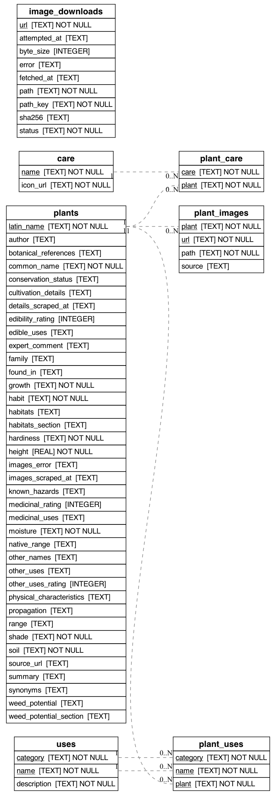

# Plants For A Future (PFAF) Data

An unofficial SQLite snapshot scraped from the [PFAF website](https://pfaf.org/user/Default.aspx).
The data and images are subject to [PFAF’s copyright terms](https://pfaf.org/user/cmspage.aspx?pageid=136).

[Browse the dataset](https://saulshanabrook.github.io/pfaf-data/) or
[open the plants table in Datasette Lite](https://lite.datasette.io/?url=https%3A%2F%2Fsaulshanabrook.github.io%2Fpfaf-data%2Fdata.sqlite&metadata=https%3A%2F%2Fsaulshanabrook.github.io%2Fpfaf-data%2Fmetadata.json#/data/plants).
Lite downloads the database into your browser on first use.

## Setup

Install [uv](https://docs.astral.sh/uv/getting-started/installation/), then:

```sh
uv sync --locked
uv run python main.py --help
uv run datasette data.sqlite -m metadata.json
```

Open the local URL printed by Datasette. `.python-version` selects Python 3.15;
uv downloads it if necessary. Python 3.11 and newer are supported; CI runs on
Ubuntu with the Python version pinned in `.python-version`. `pyproject.toml` declares dependencies and `uv.lock`
pins their versions across platforms. The lock uses stable releases, including
Datasette 0.65.5; Datasette 1.0 prereleases are excluded.

## Refreshing data

Commands are explicit: running `main.py` without a command displays help.
Start with a separate database for a small live check:

```sh
uv run python main.py --database pfaf-smoke.sqlite create-tables
uv run python main.py --database pfaf-smoke.sqlite search-plants --query 'Abelia triflora' --limit 1
uv run python main.py --database pfaf-smoke.sqlite load-plants --plant 'Abelia triflora'
uv run python main.py --database pfaf-smoke.sqlite load-images --limit 2
```

To refresh the checked-in database:

```sh
# Create missing tables and apply additive schema updates; existing rows survive.
uv run python main.py create-tables
uv run python main.py search-plants
uv run python main.py refresh-images --force --concurrency 4
uv run python main.py load-images --concurrency 4
```

`refresh-images` checks photo URLs and credits independently of descriptions.
A complete refresh visits all 8,796 plants, including the 292 names added by the
index update. Without `--force`, it resumes plants whose photos have not been
checked or whose last check failed. A successful page with no photos is also
checkpointed. Use repeated `--plant NAME` arguments or `--limit N` for a bounded
check. `--concurrency` bounds simultaneous requests and defaults to two.

`load-images` downloads current photo URLs and records their content hashes.
It reuses a file only when its recorded SHA-256 matches and Pillow can verify
and fully decode it. Transient HTTP, connection, timeout, and incomplete-response
failures get up to three attempts. Validated downloads replace their target
files atomically. Individual failures are recorded while other photos continue;
the command exits with an error if any photo failed. Rerun normally to retry
failed or unverified files, or use `load-images --force` to fetch every current
URL again. Safe original filenames are preserved; the URL ledger assigns a hash
filename when a name is unsafe or conflicts with another URL.

To update descriptions as well, run `load-plants`; `load-plants --force` revisits
already populated records, and `--plant NAME` selects a specific plant.
The HTTP cache retains responses for 24 hours. `--force` changes which records
are selected; the global `--no-cache` option forces fresh HTTP requests, for
example `uv run python main.py --no-cache refresh-images --force`.
Cached responses retain their original fetch timestamp. Full refreshes make
thousands of requests; review database and image changes before committing them.

The search uses the current alphabetical index and discovers pagination from
the response rather than assuming a fixed page count. Detail parsing tolerates
absent optional sections while rejecting pages that lack the expected plant
identity. Normalized uses, care icons, image credits, and descriptive text are
stored in SQLite.

## Files and schema

- `main.py`: scraper, schema migration, and CLI.
- `data.sqlite`: 8,796 plants, including 8,795 names in the current index and
  one retained legacy record, plus normalized uses, care information, and image sources.
  The index was refreshed on October 17, 2026, adding 292 names. Most descriptions
  still date from the original 2022 snapshot; three representative detail pages
  were refreshed with the October 17 index update.
- `images/`: downloaded photo files, with URL ownership and validation results
  recorded in `image_downloads`.
- `metadata.json`: attribution and Datasette configuration.
- `index.html` and `.nojekyll`: the GitHub Pages landing page and static publishing configuration.
- `tests/`: offline parsing, migration, database integrity, and Datasette checks.

<!-- PHOTO_REFRESH_RESULTS: Add the audited refresh date, plant/photo totals,
     and any remaining source failures here before publication. -->

The current PFAF **Native Range** section is stored as `native_range`; `found_in`
is retained for compatibility. `source_url` records the detail URL and
`details_scraped_at` records the last successful detail refresh in UTC. A null
timestamp means the refresh date is unknown. Adding columns does not imply that
all existing records have been fetched again.

`images_scraped_at` records the last successful photo metadata fetch, including
pages with no photos. `images_error` records a failed check and preserves earlier
associations for inspection. These fields are independent of
`details_scraped_at`; refreshing photos leaves descriptions unchanged.

`plant_images` stores source-listed URLs, credits, and planned local paths.
`image_downloads` has one row per URL, with its allocated path, content SHA-256,
byte count, fetch and attempt timestamps, and `pending`, `ok`, or `error` status.
An interrupted attempt remains pending. Failed attempts retain their error and
any previous successful hash; an association or existing filename alone does
not establish a successful download.

The `plant_data` view combines plant details with JSON arrays of uses, images,
and care information. Its `images` array includes only successfully refreshed
photo associations whose downloads have `ok` status. Each entry retains the
PFAF source `url` and credit text in `source`, and adds the relative local `path`.
Failed source checks or downloads are available in the underlying tables and
excluded from this array. The view is useful for export and local Datasette queries.
The default Lite link opens `plants`, which avoids the browser query timeout
seen with the original aggregate view.



`diagram.png` shows the current schema. To regenerate it after a schema change,
install [Graphviz](https://graphviz.org/download/) and run:

```sh
uv sync --locked --extra diagram
uv run python main.py draw-tables
```

## Checks and updates

```sh
uv sync --locked
uv run ruff check .
uv run ruff format --check .
uv run pytest
```

CI runs these checks, verifies dependency consistency, opens the committed
database through Datasette, and checks its JSON API and plugins. Tests do not
contact PFAF. Run the bounded smoke commands above when checking live-site
compatibility. To run the bounded live regression suite (one index and three
detail requests), set `PFAF_LIVE=1` in your environment and run
`uv run pytest tests/test_scraper.py`.

To update dependencies, run `uv lock --upgrade`, `uv sync --locked`, then the
checks above. Dependabot also proposes weekly Python and GitHub Actions updates.

## Deployment

The existing GitHub Pages deployment publishes **`main`, `/`**. Merging a PR
updates the landing page, metadata, database, and images through that existing
deployment. There are no hosting credentials or server processes to provision.
The landing page sends Datasette Lite the database and metadata URLs from the
same deployment, so forks work too. Downloaded photos are published directly as
static files under `images/`. Resolve each `plant_data.images` entry's `path`
against the Pages root to obtain its local photo URL; `url` preserves the PFAF
source location and `source` preserves its credit text.

CI tests the committed database that Pages will serve. Keep database migrations
and the migrated `data.sqlite` in the same PR. Before merging, check CI; after
merging, check the repository’s **Pages build and deployment** and open the
[published site](https://saulshanabrook.github.io/pfaf-data/).

## Possible next steps

- Give plants a stable source identifier independent of mutable Latin names,
  keeping names and synonyms as searchable attributes.
- Introduce numbered schema migrations and record scrape runs, parser versions,
  and HTML source hashes alongside the per-record URL and timestamp.
- Add FTS5 search for names and descriptive text if local search needs improve.
- Publish dated database releases with checksums so consumers can pin a snapshot
  without downloading the image archive or repository history.
